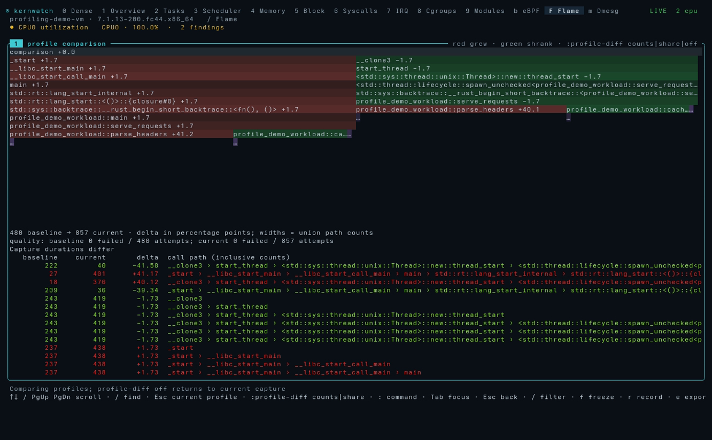

# Review the kernwatch demo

kernwatch has five previews. The README leads with the **general tour**, recorded
in a disposable Linux VM. The **flame graph preview** records capture and comparison
in the same kind of VM, and the **profiling preview** records that flow with a simpler
workload. The **live-host overview** records a real host. The **guided demo** below
uses a synthetic incident and runs without host probes.

## Record the profiling preview

```sh
python3 scripts/profile_demo.py
```

This builds the release binary and a frame-pointer-enabled Rust workload, boots
an isolated two-CPU x86-64 QEMU guest, and records the real terminal with vhs.
It requires `cc`, `qemu-system-x86_64`, `vhs`, FFmpeg, and a BTF-enabled Linux
kernel in `/boot`. Set `KERNWATCH_DEMO_KERNEL` to select another kernel.
The VM has no network, host filesystem mounts, or disk image and needs no sudo.

The sequence opens **F**, filters for `profile-demo`, captures both threads,
stops with **x**, retains a baseline with **B**, and exports it with **e**.
The workload detects that export inside the VM and changes from cache-heavy to
parse-heavy work. A second capture followed by **D** shows the change in sample
shares. Filtering for `parse_headers` demonstrates finding a demangled frame.
No stack samples or comparison values are manufactured.

The script verifies two nonempty CPU captures, demangled symbols, an exported
comparison, and changes exceeding 20 percentage points in the expected
directions. Evidence stays in `/tmp/kernwatch-profile-demo` by default; set
`KERNWATCH_DEMO_WORK` to choose another scratch directory. Only the reviewed GIF
and screenshots belong in the repository, not the raw capture reports.

Outputs are `screenshots/demo/kernwatch-profiling.gif`, a matching local MP4,
`profiling-capture.png`, and `profiling-comparison.png`. Review the recording
before publishing it. This is a controlled feature demonstration, not an
overhead benchmark; different capture lengths and stack failures remain visible.



## Record the flame graph preview

```sh
python3 scripts/profile_demo.py --flame
```

This uses the same VM and requirements, with `examples/webapp.rs` as the workload.
`webapp` is a purpose-built program, not a real service. Its function names are
chosen to read well, but the samples and kernel frames are real: three threads
burn CPU in a request path with recursive rendering, a compactor that writes to a
file, and a light metrics thread.

The sequence captures the process, follows the hottest path with **h**, zooms into
`handle_request`, walks its callees, unwinds the zoom, and searches for a frame.
It then retains a baseline, exports it, and compares a second capture. As in the
profiling preview, that export switches the workload from cache-heavy to
parse-heavy. The recording cuts VM boot and the start of the second capture.

The script runs the profiling preview's checks and also requires frames from the
recursive path, the compactor, and the kernel write path. The output is
`screenshots/demo/kernwatch-flame.gif`.

## Record the general tour

```sh
python3 scripts/profile_demo.py --tour
```

This boots the same kind of VM with four CPUs and KVM where available, and gives
each view something real to read. `webapp` does direct I/O on an expendable 1 GiB
disk image in the scratch directory, and `webapp batch` adds a pulsing neighbour.
The two run in their own cgroups, and `webapp.service` has a CPU quota low enough
to throttle it. Four kernel modules from the host's module tree load in the guest.

The sequence collects history for about 80 seconds off-camera, starts every probe
family, visits each view except Overview, then captures CPU stacks. The services,
quota and workload are staged, so a finding such as `throttled` is a true reading
of a staged machine, not a real incident. The script checks the exported capture.
The output is `screenshots/demo/kernwatch-tour.gif`.

## Record the live preview

```sh
python3 scripts/live_demo.py
```

This needs [vhs](https://github.com/charmbracelet/vhs) and FFmpeg. It starts a
bounded CPU/block/memory workload (`scripts/live_load.py`), runs the real binary
in a 160x52 terminal for a warm-up minute so the one-second history columns fill,
then records the navigation in `scripts/live_demo.tape` to
`screenshots/demo/kernwatch-live.gif` and a matching MP4. The workload and its
scratch files are removed when the recording ends.

The recording shows the recording host: its process names, cgroups, devices and
kernel log. Review the frames before publishing a new one.

## The guided demo

## Run it locally

From the project directory:

```sh
cargo build --release --locked
./target/release/kernwatch --demo-tour
```

Or use `./scripts/demo.sh`. Prefer a terminal at least 160 columns wide and 52 rows high. The tour loops through ten views, five seconds each. Press any key to stop autoplay and take control; `q` exits.

For manual exploration, run `kernwatch --demo`. Use `0` for Dense, `2` for Tasks, `3` for Scheduler, `7` for IRQ, and `d` for Diagnose.

## What the tour demonstrates

1. **Dense:** a single synthetic incident with high CPU3 softirq activity and delayed tasks.
2. **Tasks:** Envoy worker runtime and captured wake-latency data.
3. **Scheduler:** compare CPUs and their scheduling distributions.
4. **IRQ:** inspect interrupt rates and placement in right-aligned columns.
5. **Memory:** review slab growth and pressure without asserting a proven leak.
6. **Block:** distinguish outstanding request age from completed latency.
7. **Cgroups:** examine limits, placement, and service runtime.
8. **eBPF:** inspect loaded programs, links and capture overhead.
9. **Flame:** explore the worker’s sample stacks.
10. **Diagnose:** review evidence and competing explanations before taking action.

All views show the same simulated incident. The demo does not load probes, modify host controls, or claim a real incident occurred. Latency and overhead values are fixtures. It does not demonstrate live kernel compatibility or prove any proposed cause.

## Preview artifacts

- [Animated GIF](../screenshots/demo/kernwatch-demo.gif), suitable for the README.
- A local MP4 is generated alongside the GIF for review; it is not tracked by default.
- [Dense screenshot](../screenshots/current/00-dense.png) for a full-resolution still.

Rebuild the preview with:

```sh
python3 scripts/build_demo.py
```

This requires Pillow, FFmpeg with libx264, and Adwaita Mono or DejaVu Sans Mono. Set `KERNWATCH_FONT` to an alternative font file if needed. Frames are rendered by the actual Ratatui application using the same scene definitions as `--demo-tour`.
